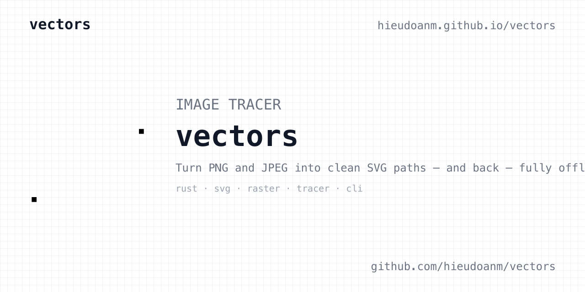
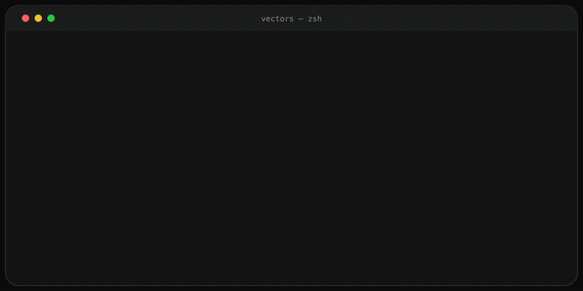

# vectors

[](https://github.com/hieudoanm/vectors/actions/workflows/ci.yaml?branch=master)  [](LICENSE)

keywords: `svg`, `vectorization`, `rust`, `cli`, `wasm`, `mcp`


<p align="center">
  
</p>

**Live demo:** <https://hieudoanm.github.io/vectors/>



**Turn PNG and JPEG images into clean SVG paths — and rasterize SVG back to PNG at any size — entirely offline.**

vectors is a classical raster-to-vector tracer written from scratch in Rust. It quantizes an image into a palette, segments pixels into regions, walks their boundaries, simplifies the result, fits Bézier curves, and emits SVG. No machine-learning models, no network calls, no service dependency — and the same input always produces byte-identical output.

The tracer ships as a CLI, an HTTP API, an MCP server, a Rust library (compiled to WebAssembly for the web app), and a Next.js landing page with an in-browser converter.

## Table of Contents

- [The Problem](#the-problem)
- [The Solution](#the-solution)
- [Features](#features)
  - [Tracing](#tracing)
  - [Surfaces](#surfaces)
  - [SVG → PNG](#svg--png)
  - [Quality harness (optional)](#quality-harness-optional)
- [Key Benefits](#key-benefits)
- [Get Started](#get-started)
- [CLI](#cli)
- [How It Works](#how-it-works)
- [Measuring Quality](#measuring-quality)
- [Crates and Packages](#crates-and-packages)
- [Use Cases](#use-cases)
- [Why This Project?](#why-this-project)
- [Project Status and Trust](#project-status-and-trust)
- [Community and Contributions](#community-and-contributions)
- [Call to Action](#call-to-action)
- [License](#license)

## The Problem

Turning a raster logo back into usable vector paths is usually either an online upload form, a heavyweight design tool, or a black box that changes its output between runs. A practical tracer needs to:

- Accept ordinary PNG and JPEG input without a pre-processing step.
- Handle colour palettes, transparency, holes, and anti-aliasing.
- Produce editable SVG — `path` elements with `fill`, not an embedded bitmap.
- Be deterministic, so a committed fixture or baseline does not churn.
- Work offline as a single binary, a library, and a server, from the same code.
- Go the other way too: render an SVG to a sized PNG for icons and previews.

vectors is built around those constraints.

## The Solution

vectors runs one linear pipeline — raster → preprocess → segment → contour → simplify → Bézier → vector model → SVG — where each stage consumes the previous stage's type and knows nothing about how the next one is rendered. The tracer is deterministic by construction (no RNG, no hash-order dependence), and is measured by rasterizing its own SVG output with an independent renderer rather than by eyeballing the paths.

The inverse direction, SVG → PNG, parses the document with `resvg`, draws it straight into a straight-alpha buffer, and encodes it with `image`. Width and height are explicit flags, so the same binary can produce a 512 px icon or a 4096 px comparison raster.

## Features

### Tracing

- **Palette and binary modes** — median-cut colour quantization (default 8 colours) or a single luminance threshold for black-and-white output.
- **8-connected segmentation** — flood fill per region, with an area filter for anti-aliasing specks.
- **Proper holes** — outer contour plus holes per path, emitted with `fill-rule="evenodd"`.
- **Douglas–Peucker simplification** — fewer points without moving the shape.
- **Least-squares Bézier fitting** — fit–measure–split, tunable per pixel.
- **Debug artefacts** — `--debug-dir` writes the quantized image, regions, curves, and curve SVG so you can see which stage went wrong.

### Surfaces

- **CLI** — one command for a single file; omit the output path to stream SVG to stdout.
- **HTTP API** — `vectors serve` exposes `/health`, `/info`, and `POST /vectors` (multipart or URL-safe base64), with per-request overrides.
- **MCP server** — `vectors mcp serve` speaks newline-delimited JSON-RPC on stdio and advertises a `vectors_trace` tool for agent clients.
- **Library** — `trace`, `to_svg`, `Raster`, `TraceConfig`, and `SvgOptions`; `VectorImage` is SVG-independent so another serializer is additive.
- **Web app** — a Next.js landing page with an in-browser converter that runs the same tracer compiled to WebAssembly; conversion happens entirely client-side.

### SVG → PNG

- **Exact or proportional sizing** — `--width` alone preserves the aspect ratio; `--width` and `--height` together set the exact grid.
- **Transparent by default** — add `--background '#ffffff'` to composite an opaque backdrop.
- **No extra tooling** — `resvg` comes from the module's `raster` feature, not from a system package.

### Quality harness (optional)

- **Measured accuracy** — `--features eval` adds `eval`, `baseline`, `golden`, and `sweep` subcommands that rasterize the emitted SVG, compare it to the source, and score MAE, PSNR, SSIM, edge agreement, primitives, and bytes.
- **Committed baselines** — one row per image, so a regression names the image that broke instead of hiding in an average.
- **Parameter sweeps** — explore `colors`, `threshold`, tolerances, and area limits across the golden suite.

## Key Benefits

- **Offline and private** — a static binary with no network calls; images never leave the machine.
- **Deterministic** — identical input yields byte-identical SVG, which makes fixtures, baselines, and diffs meaningful.
- **One pipeline, many surfaces** — CLI, HTTP, MCP, library, and desktop all call the same `trace`; the surfaces cannot drift.
- **Editable output** — real `<path>` geometry with fills and holes, not a bitmap wrapped in SVG.
- **Bidirectional** — trace raster to SVG and render SVG back to PNG, including sized exports.
- **Honest quality claims** — accuracy is measured against a committed baseline by rasterizing the actual emitted SVG.

## Get Started

### Prerequisites

- [Rust](https://rustup.rs/) 1.88 or newer (for the CLI and library).
- [Node.js](https://nodejs.org/) 26.12.1 and [pnpm](https://pnpm.io/) 12.15.0 (only for the landing page and workspace scripts).

### Build the CLI

```sh
git clone https://github.com/hieudoanm/vectors.git
cd vectors/crates/vectors-cli
cargo build --release
../target/release/vectors --help
```

The release binary lands at `crates/target/release/vectors` (the workspace target). A prebuilt `vectors`
binary is also attached to the rolling [`vectors-latest`](https://github.com/hieudoanm/vectors/releases/tag/vectors-latest)
release; `crates/vectors-cli/scripts/install.sh` downloads it.

### Convert your first image

```sh
vectors logo.png logo.svg
vectors logo.png | pango-view -          # SVG to stdout
vectors logo.svg logo.png --width 512    # back to a sized PNG
```

### Build everything

```sh
pnpm install
pnpm build        # turbo: Rust crates and web
pnpm lint
pnpm test
pnpm format
```

## CLI

```text
vectors [OPTIONS] [INPUT] [OUTPUT]
       vectors [OPTIONS] [INPUT] [OUTPUT] <COMMAND>
```

The output extension decides the format: PNG/JPEG input traces to `.svg`, while a
`.png` output rasterizes the result (and is the only valid output for an SVG
input). Omit the output path to print SVG to stdout.

| Flag                                  | What it does                                                            |
| ------------------------------------- | ----------------------------------------------------------------------- |
| `-c, --colors <N>`                    | Palette size; `1` or `2` selects black-and-white tracing (default `8`). |
| `-t, --threshold <L>`                 | Luminance cut for binary mode (default `128`).                          |
| `-d, --detail <full\|balanced\|bold>` | How aggressively small shapes are dropped.                              |
| `--min-area <PX>`                     | Ignore regions smaller than this; floored by `--detail`.                |
| `--simplify-tolerance <PX>`           | Douglas–Peucker tolerance (default `1`).                                |
| `--bezier-tolerance <PX>`             | Maximum Bézier deviation (default `0.5`).                               |
| `--backdrop <COLOR>`                  | Backdrop under transparent pixels during tracing (default `#ffffff`).   |
| `--background-index <N>`              | Palette index treated as background and never traced.                   |
| `--precision <N>`                     | Decimal places in emitted coordinates (default `2`).                    |
| `--width <PX>`, `--height <PX>`       | Target PNG size; width alone keeps the aspect ratio.                    |
| `--background <COLOR>`                | Opaque backdrop when writing a PNG (default: keep alpha).               |
| `--debug-dir <DIR>`                   | Write per-stage debug PNGs.                                             |
| `-q, --quiet`                         | Suppress the summary written to stderr.                                 |

Subcommands: `info` (palette without tracing), `serve` (HTTP), `mcp serve`
(stdio JSON-RPC), plus the feature-gated `eval`, `baseline`, `golden`, and
`sweep`.

### Examples

```sh
vectors icon.png icon.svg --colors 4
vectors photo.jpg out.svg --colors 1 --threshold 140
vectors logo.png logo.svg --detail bold --debug-dir ./trace
vectors logo.png logo.png --width 1024
vectors logo.svg logo.png --width 512 --height 512 --background '#ffffff'
vectors info logo.png
vectors serve --bind 0.0.0.0:8080
vectors mcp serve
```

## How It Works

```text
PNG / JPEG
    │
    ▼
Raster ──► LabelMap ──► Regions ──► Loops ──► Contours ──► VectorImage ──► SVG
 load      preprocess   segment    contour  simplify +      vector        emit
                                             Bézier fit
```

| Stage                                  | Question it answers                             |
| -------------------------------------- | ----------------------------------------------- |
| `core::Raster`                         | What pixels are there?                          |
| `preprocess`                           | Which palette entry does each pixel belong to?  |
| `segment`                              | Which pixels form one object?                   |
| `contour`                              | What are the boundaries of that object?         |
| `contour::simplify`, `contour::bezier` | Which points and curves represent the boundary? |
| `vector`                               | What shapes exist, and what colour are they?    |
| `vector::svg`                          | How is this written as SVG?                     |

The pipeline is one-way by design; see [docs/ARCHITECTURE.md](docs/ARCHITECTURE.md)
for the stage-by-stage walkthrough.

## Measuring Quality

A quality claim comes from rasterizing the **emitted SVG** with an independent
renderer and scoring it against the source — not from reading the paths. The
harness is feature-gated so the default binary never links a full SVG
rasterizer:

```sh
cd crates/vectors-cli

cargo run --release --features eval -- eval logo.png
cargo run --release --features eval -- eval tests/golden/images
cargo run --release --features eval -- baseline tests/golden/images
# exits 1 if any image regressed
```

Re-record a baseline deliberately when a change is an improvement:

```sh
cargo run --release --features eval -- baseline tests/golden/images --record
```

Explore a parameter instead of guessing at one:

```sh
cargo run --release --features eval -- sweep tests/golden/images colors 2 4 8 16
```

## Crates and Packages

| Path                 | What it is                                                                                                                                         |
| -------------------- | -------------------------------------------------------------------------------------------------------------------------------------------------- |
| `crates/vectors-core`      | Core Rust library: pipeline, SVG serializer, SVG → PNG renderer. Builds for `wasm32-unknown-unknown`.                                              |
| `crates/vectors-cli`  | The `vectors` binary and its surfaces: clap parsing, flag mapping, file I/O, HTTP server, MCP server, debug artefacts, and the measurement harness. |
| `packages/landing`    | Next.js landing page + in-browser converter (tracer via `@vectors/core` wasm); static export deployed to GitHub Pages.                            |
| `docs/`              | Architecture, roadmap, packaging, and design notes.                                                                                                |

The Rust crates share a Cargo workspace rooted at `crates/`; run `cargo` commands
from `crates/` to build or test the whole workspace. Each crate and package has
its own README and `AGENTS.md` with build and contribution notes.

## Use Cases

- **Logo and icon conversion** — recover editable SVG paths from screenshots, exports, or legacy raster assets.
- **Asset pipelines** — deterministic conversion in CI or a build step, with a committed baseline guarding quality.
- **Design tooling** — trace, simplify, and re-render icons at any size without a hosted service.
- **Agent workflows** — expose the tracer to an MCP client, or call the HTTP API from another service.
- **Learning computer vision** — a compact, testable implementation of segmentation, contour tracing, and curve fitting.

## Why This Project?

- **Focused scope** — a tracer, not a design suite or an online converter. The algorithms are the point.
- **Classical first** — every stage is explainable and measurable; ML is a later replacement for one stage, not the starting point.
- **Deterministic and local** — no accounts, no uploads, no vendor lock-in, no hash-order surprises.
- **One implementation, many surfaces** — the CLI, API, MCP server, and desktop app share the same library.
- **Measured, not asserted** — the eval harness scores the finished artefact against a committed baseline.

## Project Status and Trust

- **Maturity:** working tracer with a complete pipeline, CLI, HTTP API, MCP server, SVG → PNG rendering, and a WebAssembly build for the web app. It is a software demonstration, not a safety-critical production service.
- **Tested:** unit tests in each stage plus integration suites for the public API, HTTP routes, debug artifacts, rendering, and the measurement workflow. CI runs `cargo fmt --check`, `cargo clippy --all-targets -- -D warnings`, `cargo test --locked`, and a release build; the landing package runs ESLint and a Next.js static build deployed to GitHub Pages.
- **Tech stack:** Rust 1.88 (2021 edition), `image`, `resvg` (feature-gated), `clap`, `axum`, `tokio`, `tower-http`, `serde`; Next.js 16, React 19, and Tailwind CSS 4 for the landing page.
- **Documentation:** [`docs/ARCHITECTURE.md`](docs/ARCHITECTURE.md) and [`docs/ROADMAP.md`](docs/ROADMAP.md) are current. The numbered `docs/00`–`12` set is inherited from an earlier project and is **stale** — do not treat it as a specification for vectors.
- **License:** [MIT](LICENSE).

## Community and Contributions

Contributions, bug reports, and feature suggestions are welcome.

- [README for the module](crates/vectors-core/README.md) — library API and feature flags
- [README for the CLI](crates/vectors-cli/README.md) — flags, server, MCP, and the measurement harness
- [README for the landing page](packages/landing/README.md) — Next.js development
- [Architecture](docs/ARCHITECTURE.md) · [Roadmap](docs/ROADMAP.md)

Before opening a pull request, run the crate's or package's `make lint`,
`make test`, and `make format` (or the equivalent `cargo` commands). In
`crates/vectors-core` both the
default and `--features raster` builds must stay green, and `cargo build
--target wasm32-unknown-unknown` must keep working. In `crates/vectors-cli` both the
default and `--features eval` test suites must stay green.

## Call to Action

**[Get Started](#get-started)** — build the CLI and convert your first image in under a minute.

## License

This project is licensed under the [MIT License](LICENSE).
